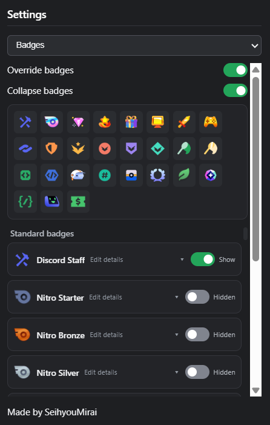
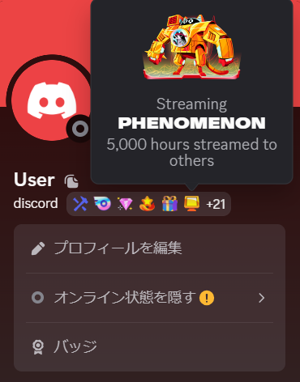
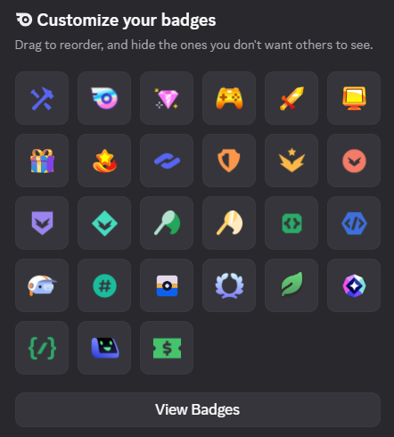
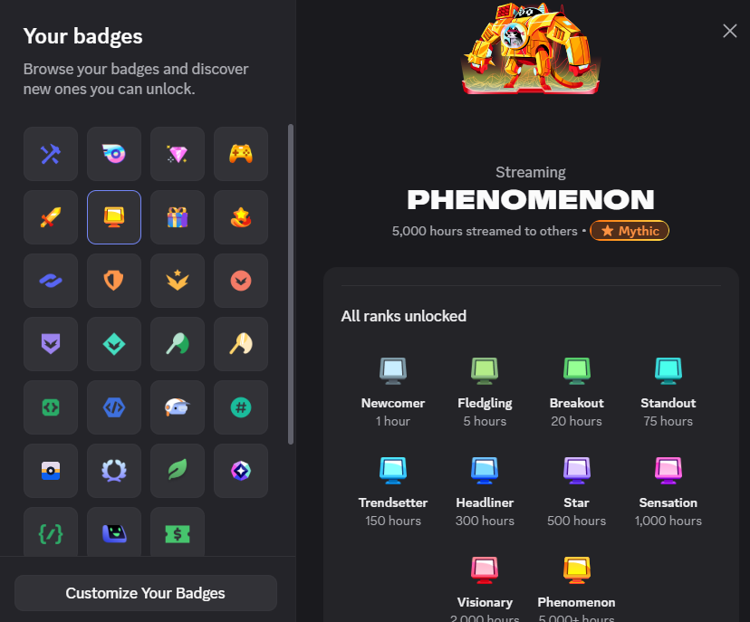

# Discord Customize Tool

An extension for customizing your Discord profile.

Freely assign existing badges, add custom badges, overwrite profile information...

You can also enable the staff feature.

This extension only supports Japanese and English (en_US).

---

# Images

## Config

## Profile
  

---

## How to Use

You can custom of your profile and rearrange their order for the badges via the extension's pop-up menu.

### Chrome console

The script for the Chrome DevTools console can be found [here](https://github.com/seihyoumirai/DiscordProfileCustomizeTool/blob/main/chrome/script.js).

No additional extensions or scripts, such as Vencord, are required.

---

## Terms of Use

1. Do not claim this as your own creation.
2. Do not redistribute.
3. Modification is not permitted.
4. Misuse is strictly prohibited.
   *  Uploading images created using this extension to social media is prohibited.
   *  Intended for personal enjoyment only.

---

## Troubleshooting

If your badges do not appear as expected, try toggling other badges on or off to refresh the display.
